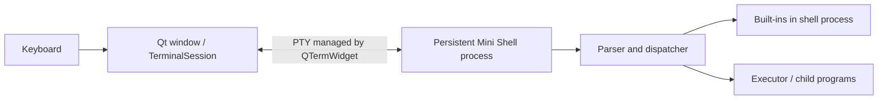

# Terminal session: integration and handoff

## Scope and evidence

Aygul's first UI checkpoint provides an embeddable `TerminalSession` and a
standalone test window. Umran owns the final window and application integration;
Sami owns visual design and interaction. This prototype is not the final UI.

User testing confirmed prompt/output, persistent working directory, responsive
resizing during `sleep 2`, exit notification, guarded window closure, and both
missing/non-executable file errors returning status 1. The existing shell suite
passed 17 tests in 1.279s. See `../tests/testing.md` for evidence and limitations.

## Architecture



Qt supplies the GUI event loop and window. QTermWidget supplies terminal
emulation and PTY communication. Our component configures the executable and
starting directory, checks input paths, and publishes session termination.
The shell reads from its terminal, parses input, and executes commands as before.
The GUI never calls the shell's `main()` or blocks in its foreground wait loop.
One shell process survives across commands, so `cd` affects subsequent commands.

## Build and run on Ubuntu through WSL

Verified environment: Ubuntu 26.04, Qt 6.10.2, CMake 4.2.3; QTermWidget 2.3.0
installed by the user. Graphical WSL support is required. Other Ubuntu versions
may use different package names. Install dependencies on each developer's machine:

```bash
sudo apt update &&
sudo apt install build-essential cmake pkgconf qt6-base-dev libqtermwidget6-2-dev libutf8proc-dev
```

From the repository root in Ubuntu Bash:

```bash
g++ -std=c++17 -Wall -Wextra -Wpedantic src/main.cpp src/builtins/builtins.cpp src/parser/parser.cpp src/parser/tokenizer.cpp src/process/executor.cpp src/process/pipeline_executor.cpp -o /tmp/minishell-ui-core &&
cmake -S tests/ui_session -B /tmp/minishell-ui-build &&
cmake --build /tmp/minishell-ui-build &&
/tmp/minishell-ui-build/minishell-session-test /tmp/minishell-ui-core
```

The final command opens the window. Its first path is the GUI executable; its
argument is our shell executable. `/tmp` binaries are local temporary build
outputs, not Git files, and may need rebuilding after restarting the environment.
The initial shell directory is the directory from which the GUI was launched.

## Umran: embed the component

Files: `src/ui/session/TerminalSession.h` and `.cpp`.
Use the test host `tests/ui_session/main.cpp` as the working integration example.

1. Construct `new TerminalSession(this)` in the main window. The parent owns
   its lifetime. Construction does not start Bash or Mini Shell.
2. Use `setCentralWidget(terminal)` for a terminal-only window, or add it to
   your layout if the window includes other controls.
3. Connect `sessionEnded` before calling `start`. Update the status and enable
   closing when notified. Do not delete the component directly inside this
   callback; keep it owned by the window or schedule deletion with `deleteLater`.
4. After showing the window, call `start(shellPath, initialDirectory, error)`
   once, as the test host does with `QTimer::singleShot(0, ...)`.
5. If it returns false, display `error`. A true result means the launch was
   requested, not proof of successful exec. Keep the terminal visible for output.
6. Preserve the prototype close guard while `isActive()` is true. Closing an
   active process tree is a separate future feature. After the session ends,
   the widget is disabled; create a new instance for another session.

The final GUI target needs C++17, AUTOMOC for `Q_OBJECT`, Qt6 Widgets,
PkgConfig::QTermWidget, both session sources, and their include directory.
Reuse the pattern in `tests/ui_session/CMakeLists.txt`, adjusting relative paths
for your target. The shell and GUI must be separate executable targets: do not
link `src/main.cpp` into the GUI target because each has its own `main()`.

## Sami: appearance and interaction

TerminalSession inherits QTermWidget. Configure its terminal font, colour scheme,
scrollbar, selection and clipboard behaviour using that component's API. Keep
session startup in Aygul's component and application layout in Umran's window.
Coordinate shortcut handling with future signal work; Ctrl+C has terminal meaning.

## Remaining boundaries

- `isActive()` tracks a launch request until a finished notification; it is not
  a live health probe or confirmation of successful exec.
- Session termination currently carries no exit status; normal exit and crash
  are not distinguished. Paths can pass checks and still fail at execution.
- stdout/stderr appear through the same terminal; do not infer structured error
  categories from text or assume a separate stderr display.
- Ctrl+C/process groups, terminating active commands on window closure, and
  background-job lifecycle need coordinated work and separate tests.
- Existing shell restrictions remain: background execution, redirection inside
  pipelines, and built-ins with redirection/in pipelines are rejected here.

## Commit preparation

Suggested commit subject:
`Add persistent Qt terminal session prototype and integration guide`

Include only the two session files, test host, its CMake file, this guide,
and updated `tests/testing.md`. Exclude generated binaries/build directories.
No commit, push, or merge was performed as part of this handoff preparation.

Suggested review description: Launch the existing Mini Shell in a persistent
QTermWidget session with preflight path checks and session-ended notification.
Add a standalone GUI host that guards closure while the session is active.
User verified the six UI checks (including both error-path subcases); existing
17 shell integration tests passed. Full signal/job control and active-process
cleanup are deferred. Umran can embed the session component in the final window.
